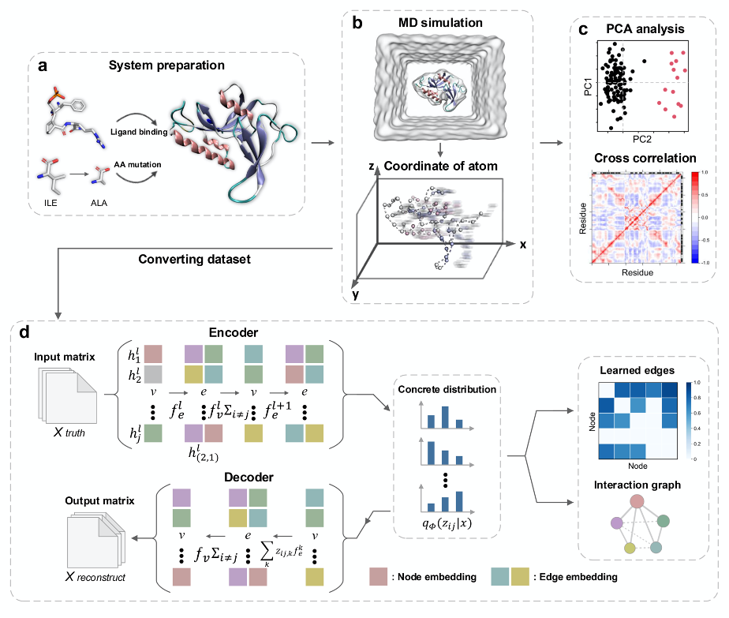

# Neural relational inference to learn allosteric long-range interactions in proteins from molecular dynamics simulations

**Abstract:** Protein allostery is a biological process facilitated by spatially long-range intra-protein communication, whereby ligand binding or amino acid mutation at a distant site affects the active site remotely. Molecular dynamics (MD) simulation provides a powerful computational approach to probe the allostery effect. However, current MD simulations cannot reach the time scales of whole allostery processes. The advent of deep learning made it possible to evaluate both spatially short and long-range communications for understanding allostery. For this purpose, we applied a neural relational inference (NRI) model based on a graph neural network (GNN), which adopts an encoder-decoder architecture to simultaneously infer latent interactions to probe protein allosteric processes as dynamic networks of interacting residues. From the MD trajectories, this model successfully learned the long-range interactions and pathways that can mediate the allosteric communications between the two distant binding sites in the Pin1, SOD1, and MEK1 systems.



### Requirements
* Python 3.10+
* PyTorch 2.0+ (with optional CUDA 11.8 support)
* NumPy, SciPy, Matplotlib, Seaborn, Pandas, NetworkX

### Installation

#### Option 1: Install from source
```bash
git clone https://github.com/juexinwang/NRI-MD.git
cd NRI-MD

# For CPU-only installation
pip install -r requirements.txt
pip install -e .

# For CUDA 11.8 installation
pip install -r requirements-cuda118.txt
pip install -e .
```

#### Option 2: Using pip with CUDA 11.8 support
```bash
pip install -e .[cuda118]
```

#### Option 3: Development installation
```bash
pip install -e .[dev]
```

### Prepare Molecular Simulation Trajectories

Place your molecular simulation trajectories in data/pdb folder. We have ca_1.pdb for the tutorial usage.

```bash
# Using the command-line tool
nri-md-convert --data-dir data/pdb --output-dir data

# Or using Python module
python -m nri_md.convert_dataset --data-dir data/pdb --output-dir data
```

This step will separate train/validation/test dataset, and generate .npy files in data folder.

### Run experiments

From the project's root folder, simply run:
```bash
# Using the command-line tool
nri-md-train --num-residues 77 --epochs 500

# Or using Python module
python -m nri_md.main --num-residues 77 --epochs 500
```

### Post Analysis

#### Visualize the inferred interaction between residues and domains
```bash
# Using the command-line tool
nri-md-visualize --filename logs/out_probs_train.npy --num-residues 77

# Or using Python module
python -m nri_md.postanalysis_visual --filename logs/out_probs_train.npy --num-residues 77
```

#### Find the shortest path between residues
```bash
# Using the command-line tool
nri-md-path --filename logs/out_probs_train.npy --source-node 46 --num-residues 77

# Or using Python module
python -m nri_md.postanalysis_path --filename logs/out_probs_train.npy --source-node 46 --num-residues 77
```

### Python 3.10+ Features

This updated version takes advantage of Python 3.10+ features including:
- Type hints with modern syntax
- Improved error handling
- Better code organization with proper package structure
- Modern PyTorch compatibility (2.0+)
- Optional CUDA 11.8 support
- Command-line tools for easy usage

### Data availability
All the MD trajectories used in the study can be downloaded from https://doi.org/10.5281/zenodo.5941385

### Cite
If you make use of this code in your own work, please cite our paper:

**Neural relational inference to learn long-range allosteric interactions in proteins from molecular dynamics simulations.**  
Jingxuan Zhu,  Juexin Wang, Weiwei Han,  Dong Xu,
Nature communications 13, no. 1 (2022): 1-16.
https://www.nature.com/articles/s41467-022-29331-3

### Reference
We thank the official implementation of neural relational inference at
https://github.com/ethanfetaya/NRI

